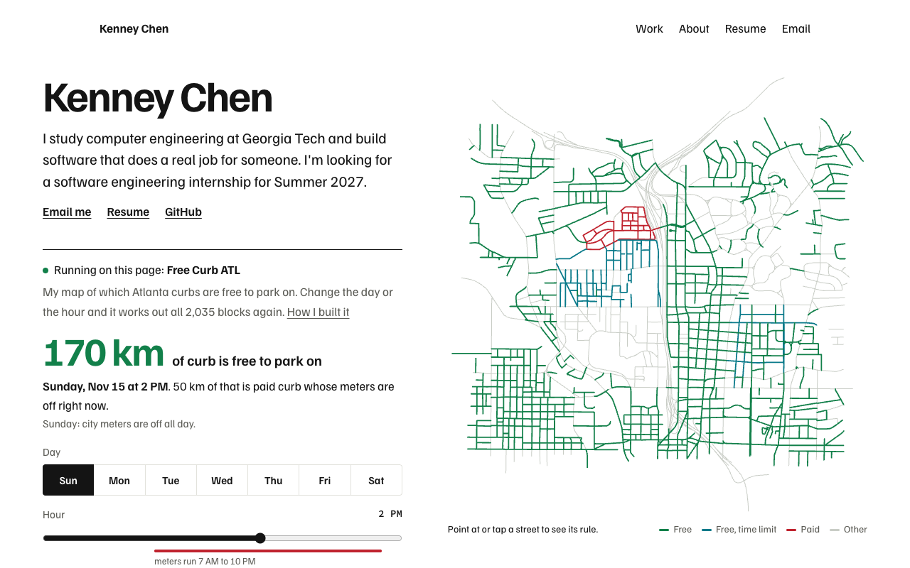

# Kenney Chen

My portfolio. It's live at [kcmake.github.io/house-of-chen](https://kcmake.github.io/house-of-chen/).

The first screen says who I am in two sentences, next to one of my projects running on the page. That project is Free Curb ATL, my map of which Atlanta curbs are free to park on. Change the day or the hour and all 2,035 blocks are worked out again.


## What's on it

- **The first screen.** Who I am, what I'm looking for, and Free Curb ATL running with its real data and its real meter rules.
- **Work.** Every project in one list, each with a small drawing of what it does, the result, and a filter.
- **Write-ups.** For the bigger projects: the problem, the first try, what broke, and what shipped, with real code pinned to a commit. Projects that can run in a browser start with a running piece.
- **About.** One paragraph whose highlighted phrases open in place, down to the code.
- **Resume.** A plain page that prints cleanly, and the one-page PDF made from it.



## How to change things

Everything you would want to edit is a small file under `src/data/` or `src/art/`. `npm run dev` shows changes as you save, and `npm run ci` tells you if something is off before it goes live.

| To change | Edit |
|---|---|
| Name, school, email, links, the resume | `src/data/site.ts` |
| The two sentences on the first screen | `src/pages/index.astro` |
| A project's one-liner, result, links, or write-up | its file in `src/data/projects/` |
| The About paragraph | `src/data/sentence.ts` |
| Colors and fonts | `src/styles/tokens.css` |

**Add a project.** Copy a short file like `src/data/projects/portify.ts`, rename it, and fill it in. It shows up in the work list by itself:

- `group` puts it under Projects or Leadership.
- `order` sets its place in that list, lowest first. The existing ones go up in tens, so 25 lands between 20 and 30.
- `tags` are what the filter matches: AI, Web, Tools, Hardware, Leadership.
- Add a `writeup` and it gets a page at `/work/<slug>/`.

**Give it a drawing.** Add an entry under the same slug in `src/art/index.ts`. The drawings share a 96 by 64 grid and a handful of classes, listed at the top of that file. A test fails if a project has no drawing.

**Give it a running piece.** Put a pure model and a small script under `src/demos/<name>/`, make a component for it, add the name to `demo` in `src/data/types.ts`, and add a line to `src/components/Demo.astro`. Then set `demo: '<name>'` on the project.

**Refresh the map data.** After Free Curb ATL changes, run `node scripts/make-curb-data.mjs <path to its data/parking.geojson>`. A test checks the totals against the numbers in the write-up.

## How it works

- `src/demos/curb/` is Free Curb ATL: the meter hours ported from the real project and tested against the same cases, a model that works out each block's color, and a canvas script that draws them. The block data is `public/demo/curbs.json`, loaded after the text is on screen.
- `src/demos/sniper/` is CourseSniper's seat rule, ported from the bot. An empty seat is not a free seat when people are waiting for it, and the demo lets you find that out.
- `src/data/projects/` has one file per project. The work list, the write-ups, and the resume read from the same files, so they can't disagree.
- `src/art/index.ts` holds one hand-drawn SVG per project.
- `src/data/sentence.ts` and `src/scripts/sentence.ts` are the About paragraph and the script that opens it.
- The words are in the HTML from the start. Without JavaScript the first screen still says who I am and links to the full map, and every phrase on the About page is open.
- `scripts/ai-look-check.mjs` fails the build when the code drifts toward the looks AI tools default to: stock typefaces, gradient headline text, blurred glass panels, purple palettes, and stock phrases.


## Run it

Needs Node 22.23 or newer.

```bash
npm install
npm run dev        # http://localhost:4321/house-of-chen/
```

```bash
npm run look       # the AI-look check
npm test           # unit tests
npm run build
npm run test:e2e   # browser and accessibility tests; uses your installed Chrome locally
```

`npm run ci` runs all four in order, the same as GitHub Actions does before it deploys.

The resume PDF, the link preview, and the screenshots above are made from the built site:

```bash
npm run build && npm run assets && npm run build
```

It builds for GitHub Pages at `/house-of-chen/` by default. Set `SITE_URL` and `BASE_PATH` to build for another address, like a custom domain at `/`.

## History

The first version of this site was built as my family's restaurant, with a menu, a swinging door to the kitchen, and a lazy Susan. It told a story, but a visitor had to learn the restaurant before learning anything about me. The second was one paragraph that opens in place. It read quickly but showed nothing. This version runs the work instead of describing it, and the paragraph lives on the About page. Both earlier versions are in the git history.

## License

The code is MIT licensed. The writing, photos, and family material are copyright Kenney Chen and aren't covered by that license.
