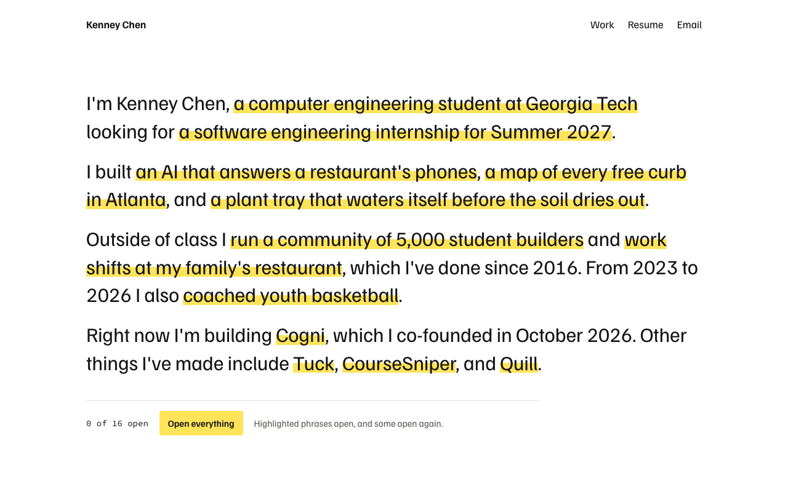
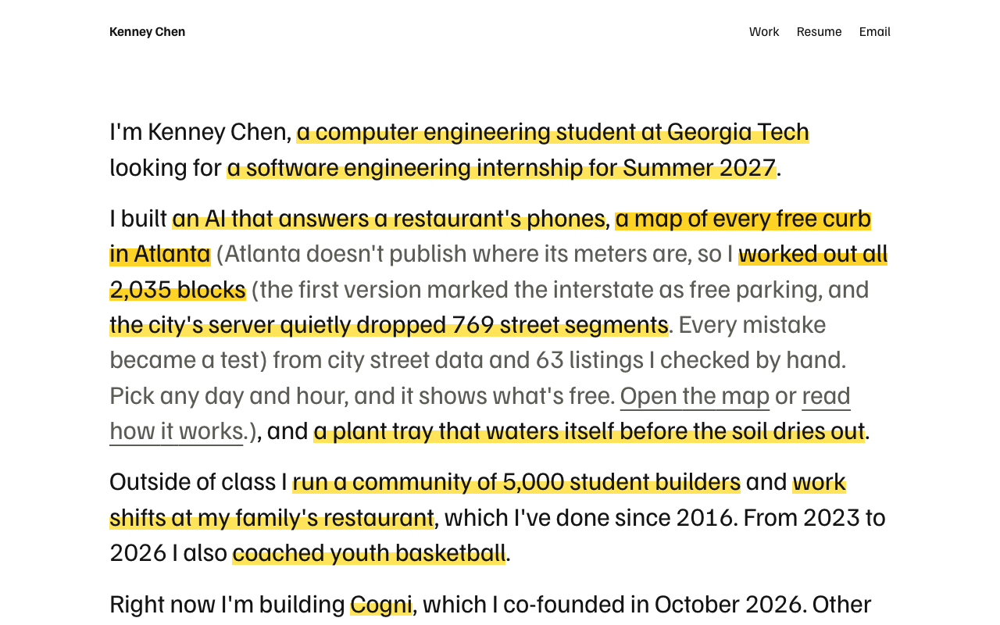
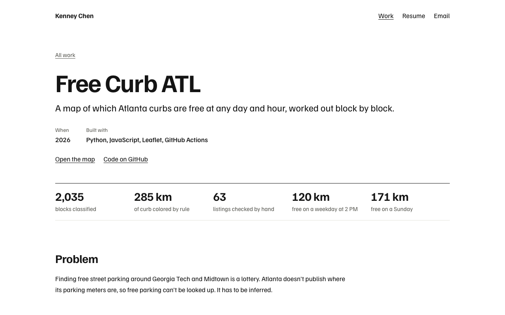

# Kenney Chen

My portfolio. It's live at [kcmake.github.io/house-of-chen](https://kcmake.github.io/house-of-chen/).

The home page is one paragraph about me. Every highlighted phrase opens more of the story in place, and some of what opens has highlights of its own, down to the code. A recruiter can stop after the first read. An engineer can keep opening.



## What's on it

- **The paragraph.** Who I am, what I've built, and the internship I'm looking for, with the details one tap away.
- **Write-ups.** For the bigger projects: the problem, the first try, what broke, and what shipped, with real code pinned to a commit.
- **Work.** Every project in one list, with the result next to each.
- **Resume.** A plain page that prints cleanly, and the one-page PDF made from it.



## How it works

- `src/data/sentence.ts` is the paragraph as data: plain text, highlighted phrases, and what each phrase opens. Tests check that every phrase opens to something and that the fully open paragraph still reads as clean sentences.
- `src/data/projects/` has one file per project. The work list, the write-ups, and the resume read from the same files, so they can't disagree.
- `src/scripts/sentence.ts` opens and closes phrases. Words slide from where they were to where they end up instead of jumping. They stay inline text and move with relative offsets, because an inline-block lets the browser wrap a lone comma onto the next line.
- Everything is in the HTML from the start. Without JavaScript, every phrase is simply open.
- `scripts/ai-look-check.mjs` fails the build when the code drifts toward the looks AI tools default to: stock typefaces, gradient headline text, blurred glass panels, purple palettes, and stock phrases.



## Run it

Needs Node 22.23 or newer.

```bash
npm install
npm run dev        # http://localhost:4321/house-of-chen/
```

```bash
npm run look       # the AI-look check
npm test           # unit tests
npm run build
npm run test:e2e   # browser and accessibility tests; uses your installed Chrome locally
```

The resume PDF, the link preview, and the screenshots above are made from the built site:

```bash
npm run build && npm run assets && npm run build
```

It builds for GitHub Pages at `/house-of-chen/` by default. Set `SITE_URL` and `BASE_PATH` to build for another address, like a custom domain at `/`.

## History

The first version of this site was built as my family's restaurant, with a menu, a swinging door to the kitchen, and a lazy Susan. It told a story, but a visitor had to learn the restaurant before learning anything about me, so this version keeps one idea. The restaurant is still in the git history.

## License

The code is MIT licensed. The writing, photos, and family material are copyright Kenney Chen and aren't covered by that license.
