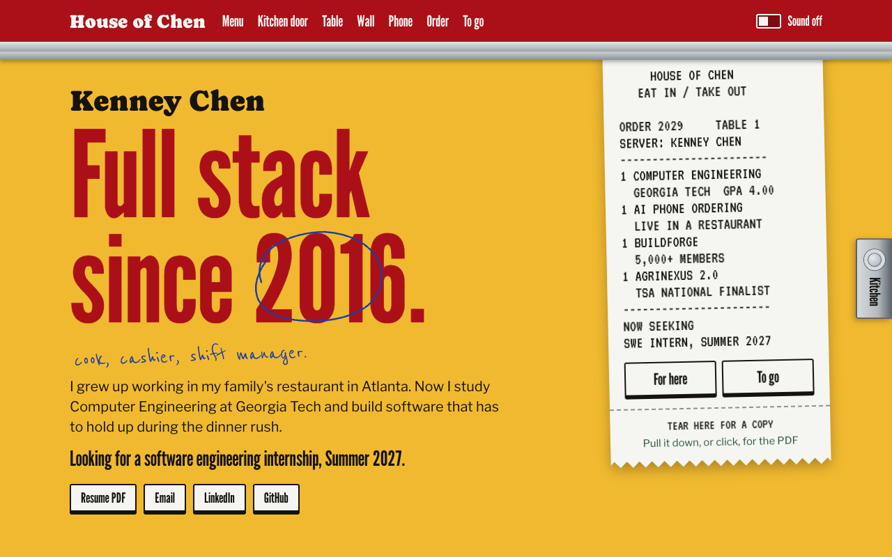
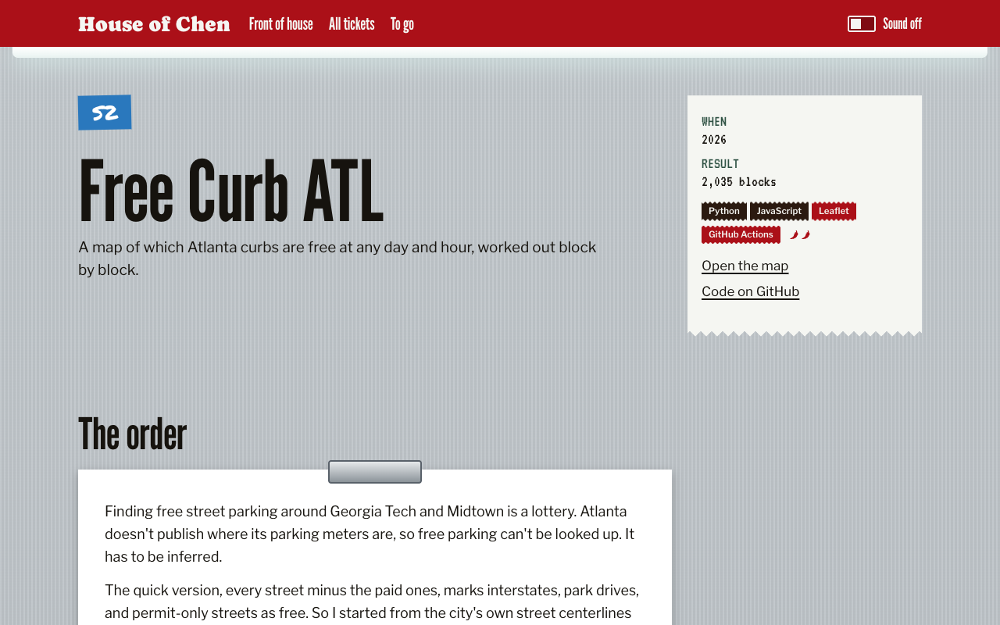

# House of Chen

Kenney Chen's portfolio, built as the restaurant he grew up in.

I've worked front of house and back of house at my family's restaurant since 2016. In software, those are the frontend and the backend, so this site has both: a printed menu out front for anyone in a hurry, and a kitchen behind a swinging door for anyone who wants to see how things are made.



## What's on it

- **The menu.** Every project, with the result printed where a menu prints the price. Combo platters circle what a backend, embedded, or founder-minded reader should look at. Type a number like `W1` to jump to that dish.
- **The kitchen.** Each dish gets a ticket with its architecture, real code from its repo pinned to a commit, and a Refire log of what broke and how it got fixed.
- **To go.** A plain one-page version that prints cleanly, and the PDF made from it.
- **Things to touch.** A swinging door, a lazy Susan with real momentum, a ticket you can tear off, a tear-off calendar, a fortune cookie, a wall phone that parses your order, and an order pad that prints a ticket.



## How it works

- `src/data/projects/` has one file per dish. Each feeds the menu, its kitchen ticket, the To go page, the PDF, and the phone, so they can't disagree.
- `src/pages/` turns that data into static pages with Astro. JavaScript only runs where something moves.
- `src/lib/physics.ts` holds the springs and friction behind the door, the table, and the handset. There's no animation library.
- `src/lib/order.ts` is the phone: it matches what you say against the menu, works out what you want, validates the order, and answers. It's a small rule-based stand-in for the LLM agents I built for phone orders at Osho.
- `scripts/ai-look-check.mjs` fails the build when the code drifts toward the looks AI tools default to: stock typefaces, gradient headline text, blurred glass panels, purple palettes, and stock phrases.
- Going between the front and the kitchen swings the whole page like a door, using cross-document view transitions in browsers that support them.

## Run it

Needs Node 22.23 or newer.

```bash
npm install
npm run dev        # http://localhost:4321/house-of-chen/
```

```bash
npm run look       # the AI-look check
npm test           # unit tests
npm run build
npm run test:e2e   # browser and accessibility tests; uses your installed Chrome locally
```

The resume PDF, the link preview, and the screenshots above are made from the built site:

```bash
npm run build && npm run assets && npm run build
```

It builds for GitHub Pages at `/house-of-chen/` by default. Set `SITE_URL` and `BASE_PATH` to build for another address, like a custom domain at `/`.

## Still to come

- The receipt font, made from a scan of the restaurant's own printer. VT323 stands in for now.
- Photos of the real hardware plated on the restaurant's dishes. Drawings stand in for now.
- Sound recorded at the restaurant. The current sounds are synthesized and off by default.
- The order pad printing on a real receipt printer through an ESP32-S3. For now it opens an email.

## License

The code is MIT licensed. The writing, photos, and family material are copyright Kenney Chen and aren't covered by that license.
